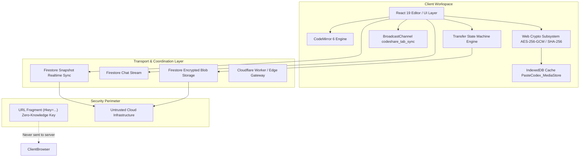
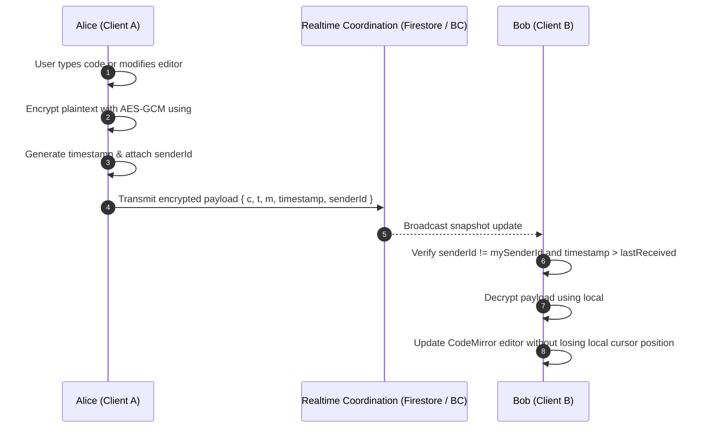
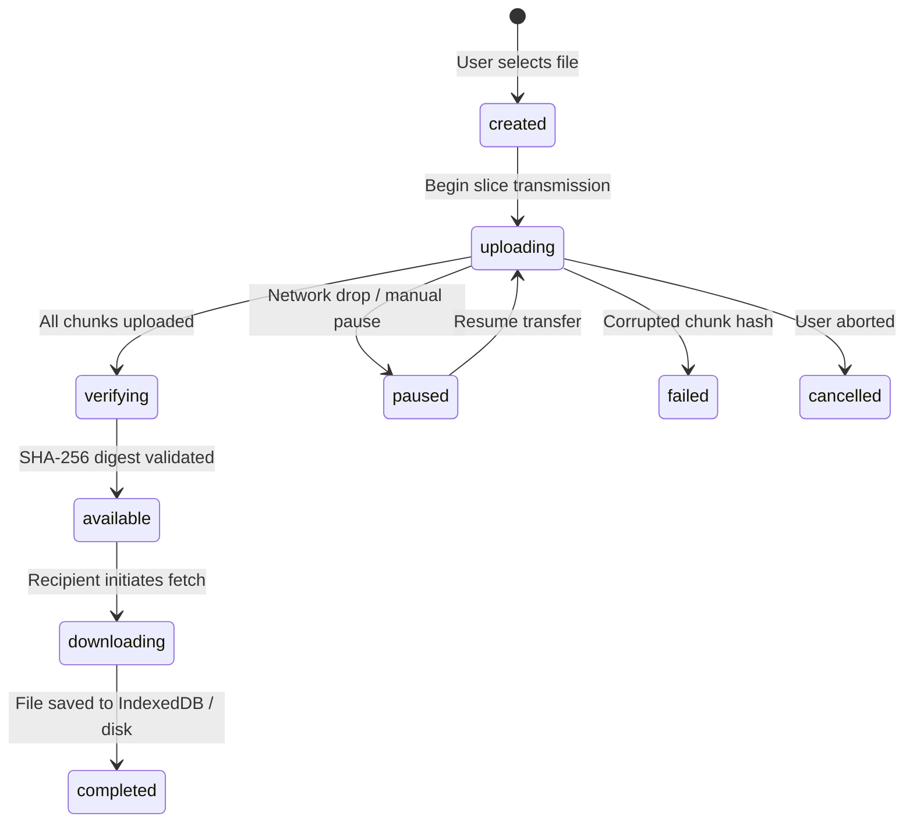

# Current and Target System Architecture (Phase 0 & 1)

## 1. System Overview and Core Boundaries

PasteCodex separates interactive collaboration, large media transfer, and state synchronization across three distinct architectural planes:

---

## 2. Traffic Class Separation

### A. Collaborative Code Traffic
- **Protocol**: Real-time snapshot diffs with monotonic timestamps (`timestamp`) and sender IDs (`senderId`).
- **Conflict Strategy**: Last-Write-Wins with active-tab suppression (suppressing self-emitted echo packets) and in-flight debounce (250ms).
- **Transport**: Firestore real-time snapshot listeners for wide-area sync; native `BroadcastChannel` (`codeshare_tab_sync`) for 0ms same-origin cross-tab sync.
- **Message Bound**: Document updates are strictly text-based and limited to 256 KiB. Bulk binary payloads are barred from this channel.

### B. File Transfer Traffic
- **Protocol**: Chunked transfer state machine with per-chunk and whole-file SHA-256 checksums.
- **Transfer States**:
  `created` ➔ `uploading` ➔ `verifying` ➔ `available` ➔ `downloading` ➔ `completed`
  (Terminal & recovery states: `paused`, `failed`, `cancelled`, `expired`).
- **Chunking Model**: 450 KiB slice boundaries. Each slice is encrypted with AES-GCM (using unique IV) before leaving the client browser.
- **Deduplication and Local Caching**: Received files are verified against expected SHA-256 digests and immediately written to browser IndexedDB, eliminating repetitive network transfers on page reloads.

### C. Control-Plane Traffic
- **URL Structure**:
  - `/:id` — Unique alphanumeric room slug (cryptographically random, 6–8 characters).
  - `?v=1` — Optional view-only enforcement flag.
  - `#key=<hex>&d=<base64>` — Zero-knowledge client-only URL fragment:
    - `key`: 256-bit AES-GCM symmetric decryption key.
    - `d`: Optional compact initial state token enabling zero-server offline instant booting.

---

## 3. Data Flow Diagram: Zero-Knowledge Collaboration

---

## 4. Storage Abstraction and Lifecycle

